# Steven's Arcade 🎮

A small browser arcade: ten games in plain HTML, CSS and JavaScript. No frameworks, no build step.

**Play it here → https://steven-lyt.github.io/**

[English](#english) · [繁體中文](#繁體中文)

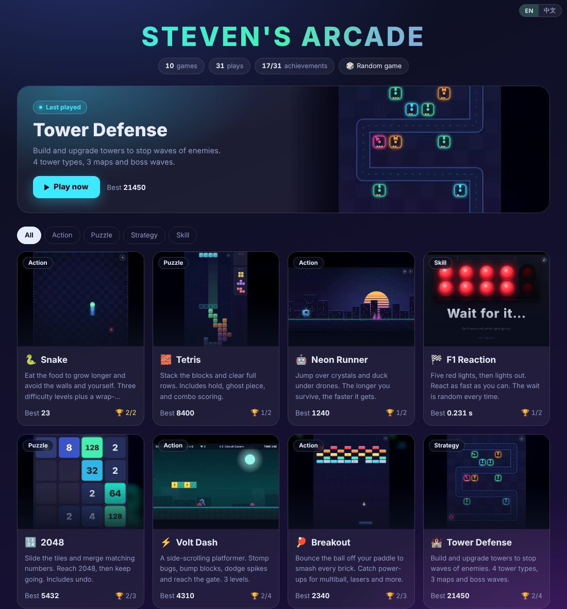

---

## English

### Games

| | Game | What it is |
|---|---|---|
| 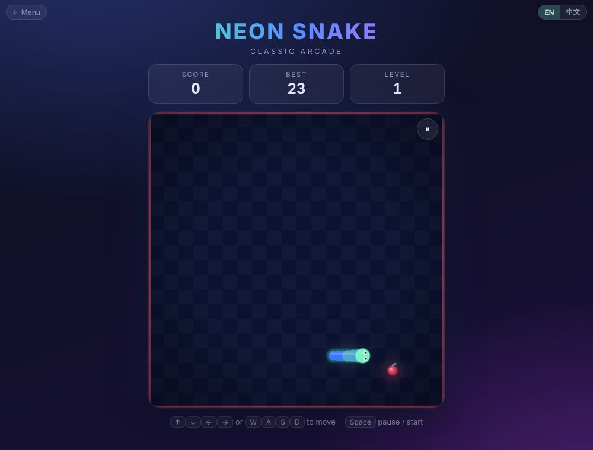 | **Snake** | Eat food, grow longer, avoid the walls and yourself. Three difficulty levels and a wrap-around mode. |
| 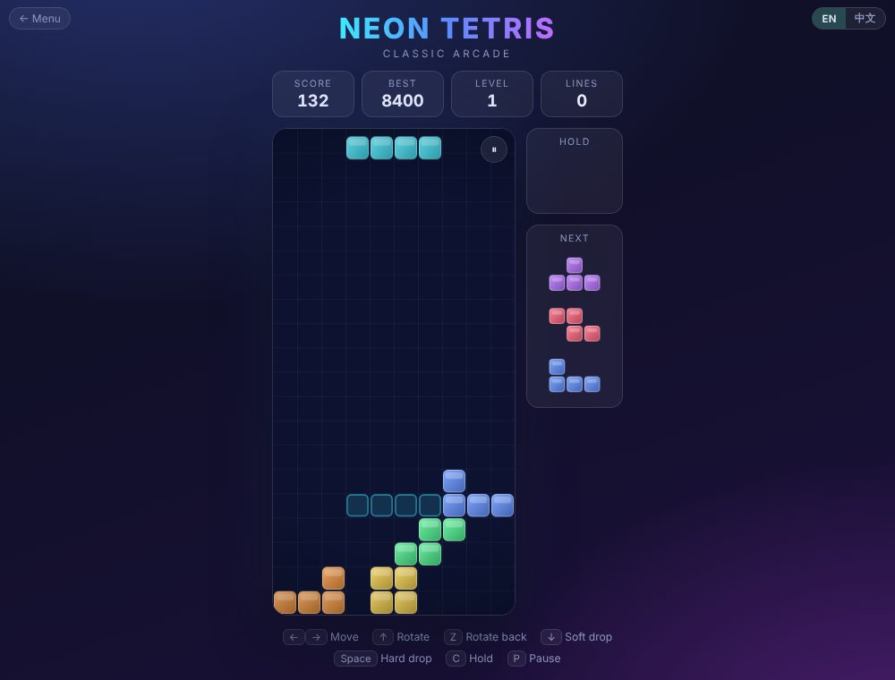 | **Tetris** | Hold, ghost piece, 7-bag randomizer, wall kicks, combos, and a start-level option. |
| 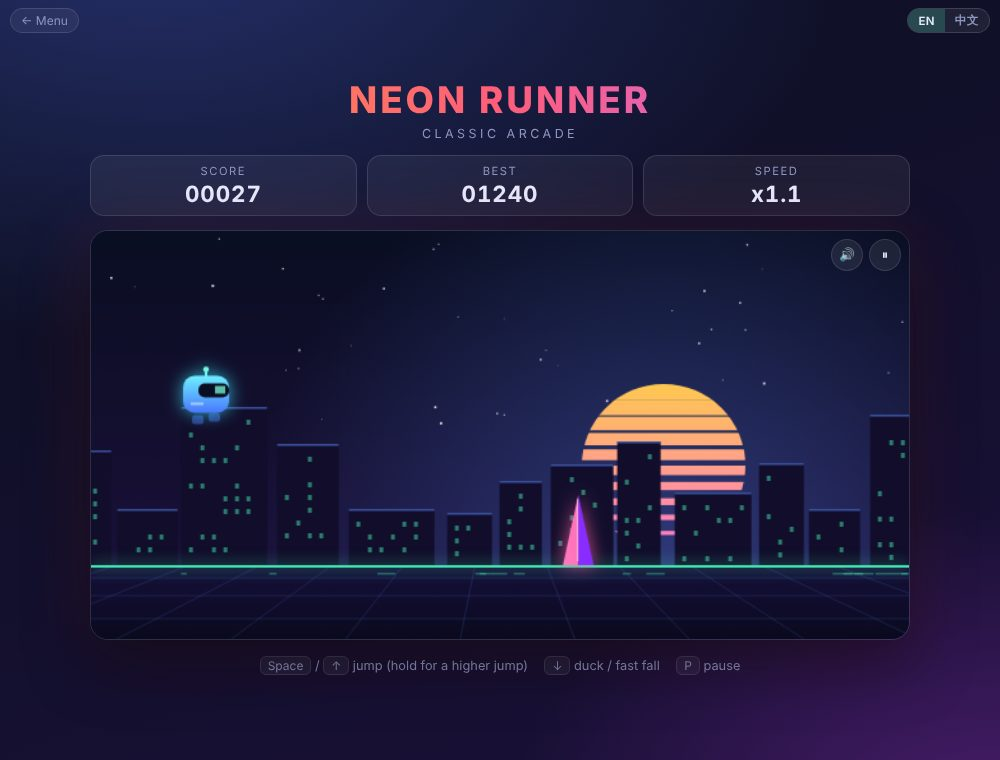 | **Neon Runner** | An endless runner. Jump over crystals, duck under drones, and keep up as the speed climbs. |
| 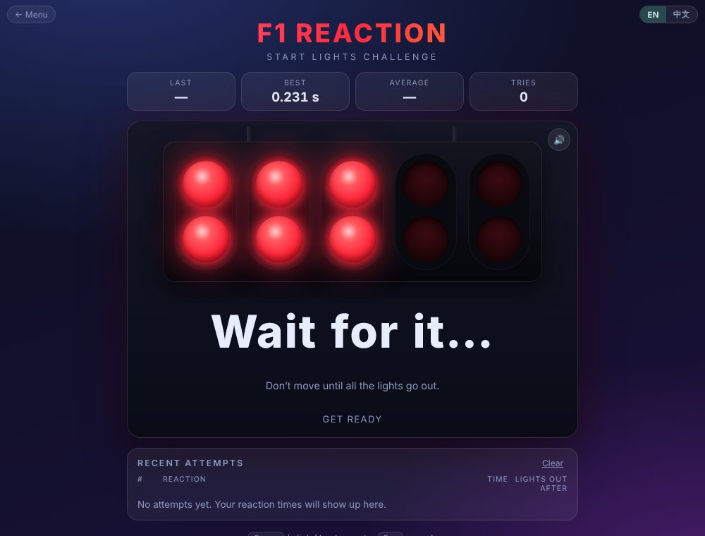 | **F1 Reaction** | Five red lights, then lights out. The wait is random every time. Jump starts are caught. |
| 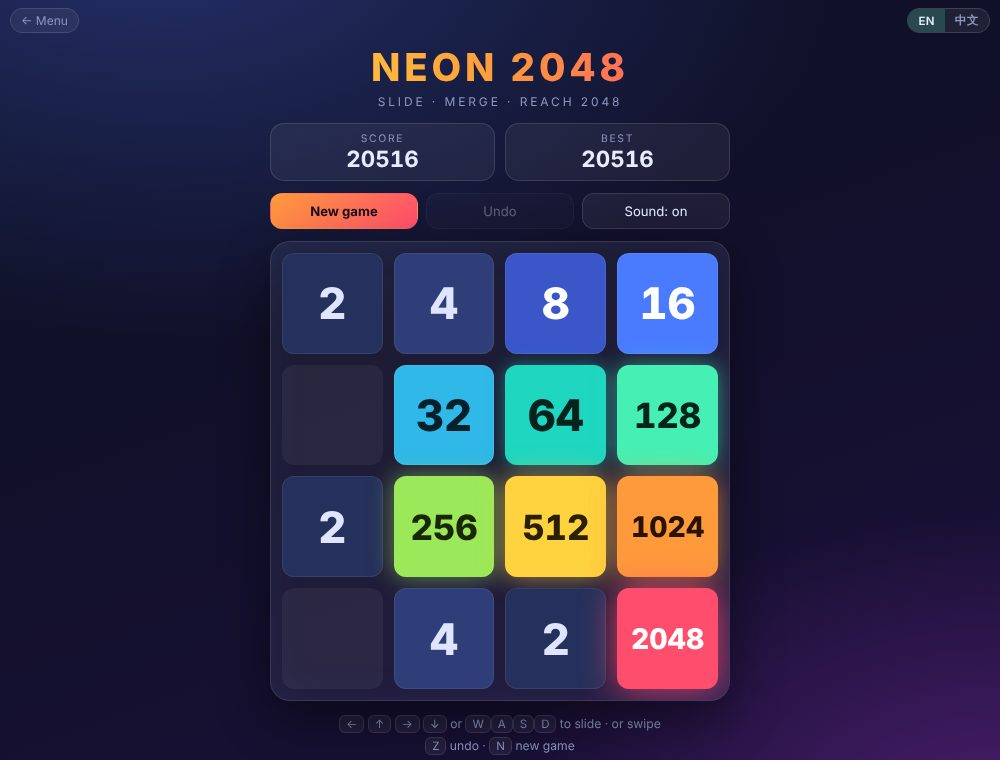 | **2048** | Slide and merge tiles. Smooth animations, undo, and your board is saved if you refresh. |
| 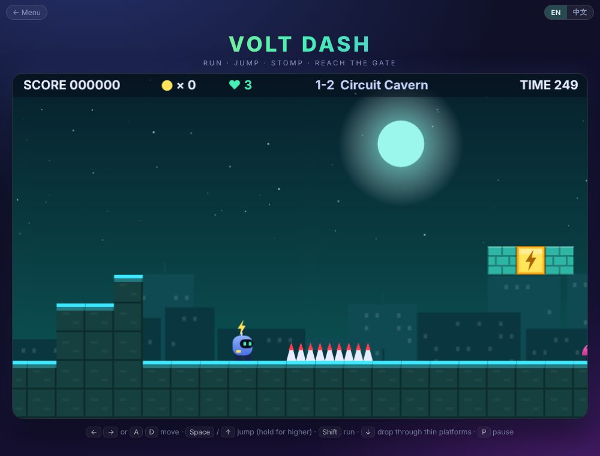 | **Volt Dash** | A side-scrolling platformer with an original hero. Stomp bugs, bump blocks, dodge spikes, reach the gate. 3 levels with checkpoints. |
| 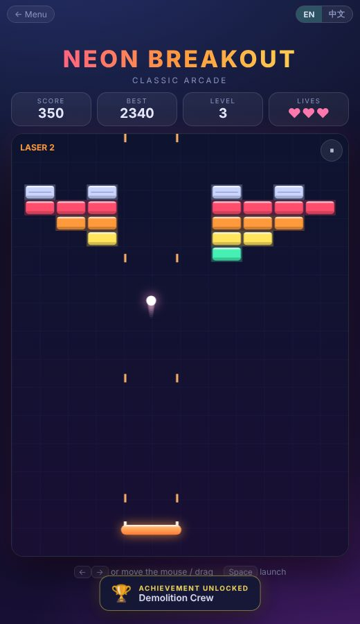 | **Breakout** | Classic brick breaker. 5 levels, tough and steel bricks, and power-ups: wide paddle, multiball, slow, laser and extra life. |
| 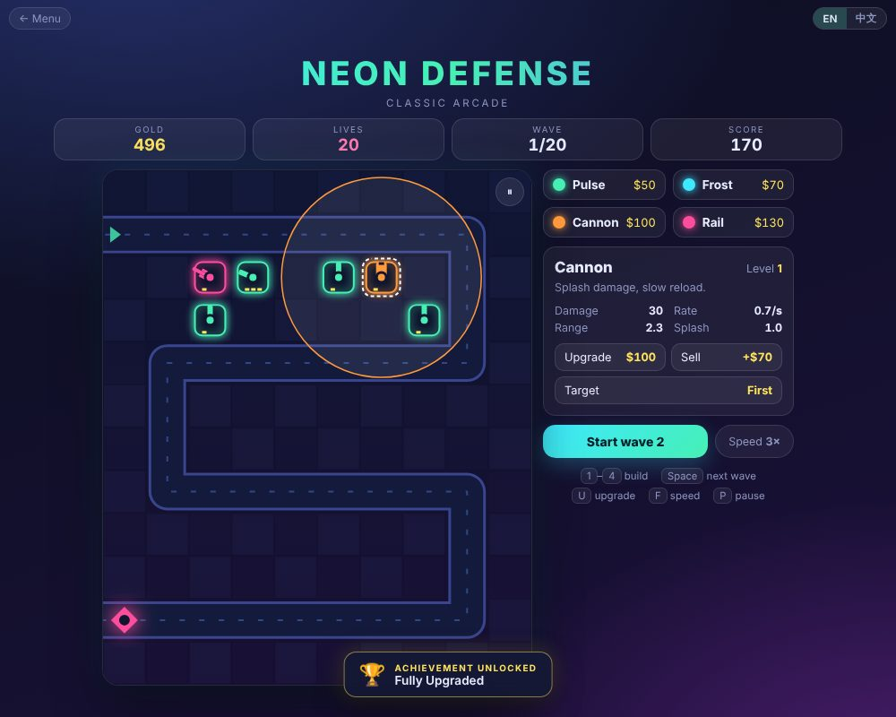 | **Tower Defense** | Build and upgrade 4 kinds of towers to stop 20 waves. 3 maps, boss waves, target modes and 1×–3× speed. |
| 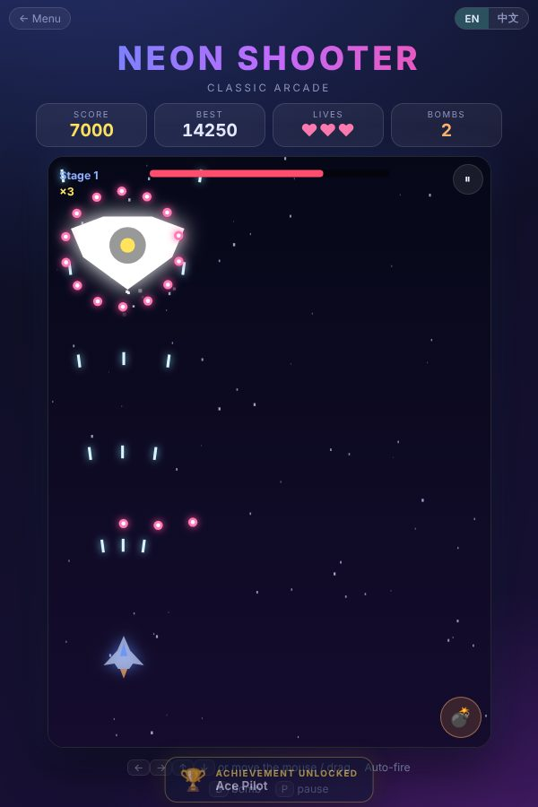 | **Space Shooter** | Auto-fire vertical shooter. 4 enemy types, a boss every stage, 4 weapon levels, shields and bombs. |
| 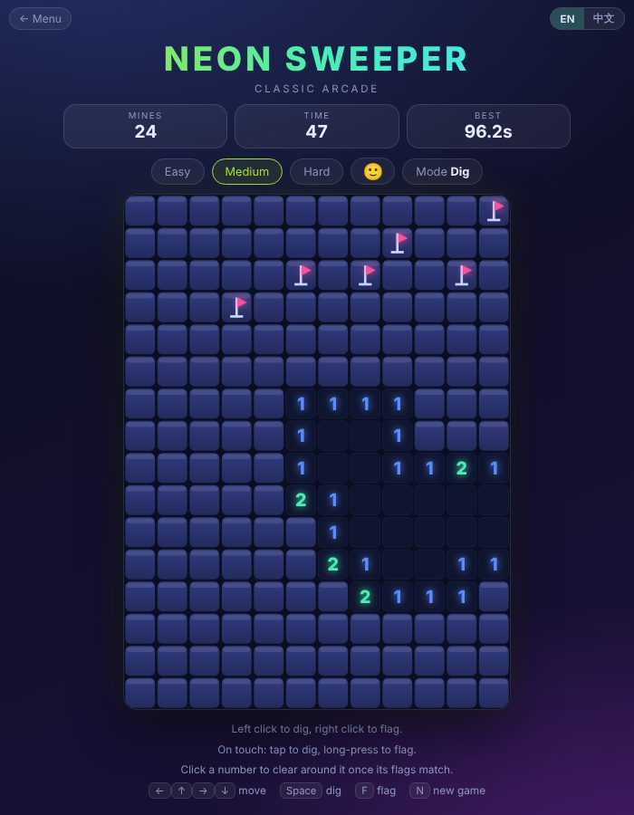 | **Minesweeper** | Three board sizes, a safe first click, flags, chording, and best times. Long-press to flag on touch. |

### Features

- **Works on desktop and mobile.** Keyboard on a computer, on-screen buttons or swipes on a phone.
- **English / 中文 switch** (top right of every page). The choice is saved.
- **A menu that remembers you.** It shows the game you played last, filters games by type (Action, Puzzle, Strategy, Skill), has a random-game button, and shows your best scores and achievement progress. Each card plays a short gameplay clip when you hover over it.
- **31 achievements** that unlock as you play, grouped by game on the menu page.
- **Best scores and progress are saved in your browser** (`localStorage`). Nothing is sent anywhere.
- **Every game is one self-contained file.** Shared code (language and achievements) lives in `shared.js`.

### Project structure

```
index.html      menu: last played, filters, best scores, achievements
shared.js       language switch + achievements
snake.html  tetris.html  runner.html  reaction.html  2048.html  volt.html  breakout.html  towerdefense.html  shooter.html  mines.html
thumbs/         game thumbnails used on the menu
clips/          short gameplay previews (webm + mp4)
screenshots/    images used in this README
```

### Run it on your computer

```bash
git clone https://github.com/Steven-lyt/steven-lyt.github.io
cd steven-lyt.github.io
python3 -m http.server 8000      # then open http://localhost:8000
```

You can also just open `index.html` in a browser.

### Notes

- Built with Claude as a coding partner.
- The hero of Volt Dash is an original character. The game is a platformer in the classic style, not a copy of any existing game.

---

## 繁體中文

這是一個放在瀏覽器裡的小型遊戲廳，共 6 個遊戲，只用 HTML、CSS 和 JavaScript 寫成，不需要任何框架或建置步驟。

**線上遊玩 → https://steven-lyt.github.io/**

### 遊戲

| 遊戲 | 簡介 |
|---|---|
| **貪吃蛇** | 吃食物變長，避開牆壁和自己。三種難度，另有穿牆模式。 |
| **俄羅斯方塊** | 有保留、幽靈方塊、7 包隨機、踢牆旋轉、連擊，可選起始等級。 |
| **霓虹跑酷** | 無盡跑酷。跳過水晶、蹲過無人機，速度會越來越快。 |
| **F1 起跑反應** | 五盞紅燈後熄滅，等待時間每次隨機，會判定偷跑。 |
| **2048** | 滑動並合併方塊。有動畫、可復原，重新整理後盤面不會消失。 |
| **Volt 衝刺** | 橫向捲軸跳台遊戲，主角是原創角色。踩扁蟲子、頂方塊、閃開尖刺，抵達大門。共 3 關，有檢查點。 |
| **打磚塊** | 經典打磚塊。5 個關卡，有硬磚和鋼磚，道具包括加寬、多球、減速、雷射和加一命。 |
| **塔防** | 建造並升級 4 種防禦塔，擋下 20 波敵人。3 張地圖、首領關、可切換攻擊目標，還有 1×–3× 速度。 |
| **太空射擊** | 自動射擊的直向射擊遊戲。4 種敵人、每關一隻首領、4 級武器、護盾和炸彈。 |
| **踩地雷** | 三種大小、第一步保證安全，可插旗、快速開格，並記錄最佳時間。觸控長按可插旗。 |

### 特色

- 電腦用鍵盤，手機用螢幕按鈕或滑動。
- 每個頁面右上角可以切換 **English / 中文**，選擇會被記住。
- **會記住你的選單**：顯示上次玩的遊戲、依類型篩選（動作、益智、策略、技巧）、隨機選一款，並顯示最高分與成就進度；滑鼠移到卡片上會播放遊戲短片。
- **31 個成就**，在選單頁依遊戲分組顯示。
- 最高分和進度都存在你的瀏覽器（`localStorage`），不會傳送到任何地方。

### 製作

與 Claude 一起寫程式製作。
